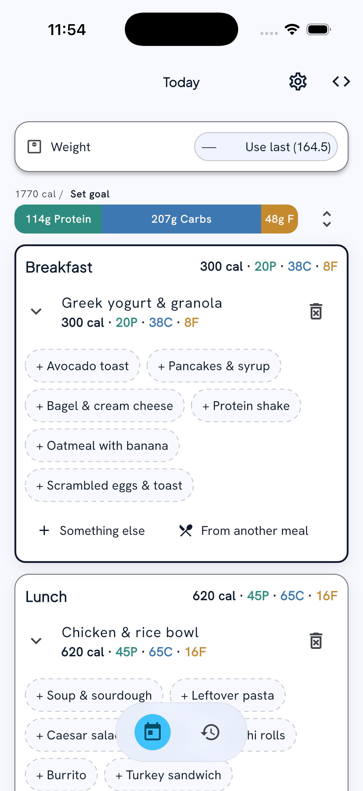
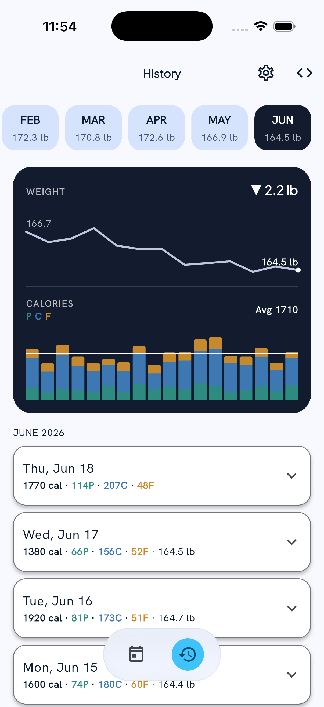

# The Usual

[![coverage][coverage_badge]](https://github.com/jacobs-team/the_usual/actions)
[![style: very good analysis][very_good_analysis_badge]][very_good_analysis_link]
[![License: MIT][license_badge]][license_link]

A meal and calorie tracker built around the idea that most days you eat the same things. Instead of searching a food database every time, you build a small library of meals you actually eat, your "usuals", and log them with a single tap.

## What is The Usual?

You set up your usual meals once, grouped by Breakfast, Lunch, Dinner, and Snacks. Each usual already carries its own nutrition, so logging is just tapping it. When you eat something new, you can describe it in text or snap a photo and Claude estimates the food name and macros for you to confirm.

Core features:

- **Usuals library.** Preset meals per time of day. Tap one to log it. The quantity is built in, so you only tweak it on the off day you eat more or less than usual.
- **AI nutrition.** Describe a meal or take a photo and get an estimated name, calories, and macros (protein, carbs, fat) to review before logging. Powered by Claude.
- **Today screen.** Running calorie total against your goal, meals grouped by time of day, with the current meal slot auto-highlighted. Inline weight check-in.
- **Weight tracking.** Optional check-ins on a schedule you choose (daily, weekly, biweekly, monthly), with a goal weight and lbs/kg.
- **Reminders.** Meal and weight check-in nudges as OS notifications or in-app prompts. Per-meal times or a single end-of-day prompt. It skips reminders for anything you already logged.
- **History.** Browse past days month by month with a calorie and weight chart, and edit any meal or weigh-in retroactively.

_The Usual works on iOS, Android, Web, and Windows._

## How it works

1. **Onboard.** A short setup flow walks you through building your usuals, logging your first meal, choosing a reminder style, and setting optional calorie and weight goals.
2. **Log from Today.** Open the app and the meal slot for the current time is highlighted. Tap a usual and it's logged. Recently logged meals surface as quick picks.
3. **Add something new.** For anything not in your usuals, type a description or take a photo and let the AI fill in the nutrition, then confirm.
4. **Check in.** Enter your weight inline on the Today screen when prompted.
5. **Review.** The History tab shows your days over time with a calorie and weight chart, and lets you fix anything after the fact.

## Screenshots

<!-- Add screenshots / GIFs here once captured.



-->

## Getting Started 🚀

This project uses flavors and external configuration files for environment management.

### Prerequisites

This project uses [FVM](https://fvm.app/) to manage Flutter SDK versions. To ensure you are using the correct version defined in .fvmrc, run the following command. Keep in mind you may need to restart your terminal:

```sh
fvm use
```

### Configuration

Environment values are injected at build time from JSON files in `config/` via `--dart-define-from-file`. Copy `config/example.json` to create your own and fill in the values:

```json
{
    "ANTHROPIC_API_KEY": ""
}
```

`ANTHROPIC_API_KEY` powers the in-app AI nutrition estimates. It is optional. When it is empty the app runs normally and the AI features show a setup message instead of calling Claude.

### Run the App

To run a specific flavor, use the Run and Debug sidebar in VSCode or the following terminal commands:

```sh
# Development
$ fvm flutter run --flavor development --target lib/main_development.dart --dart-define-from-file=config/dev.json

# Production
$ fvm flutter run --flavor production --target lib/main_production.dart --dart-define-from-file=config/prod.json
```

It's likely that you will need to generate code when working within this project. Many aspects of this project use code generation, including go_router (if using typed routes), bloc states and events, data models, assets like images or icons, and any dependencies that are annotated for use with injectable.

To let the build runner run in the background, run:

```sh
fvm dart run build_runner watch --delete-conflicting-outputs
```

To run the build_runner once, run:

```sh
fvm dart run build_runner build --delete-conflicting-outputs
```

## Running Tests 🧪

To run all unit and widget tests use the following command:

```sh
$ very_good test --coverage  --test-randomize-ordering-seed=random --exclude-coverage "**/*.g.dart" --exclude-coverage "**/*.freezed.dart" --exclude-coverage "lib/l10n/gen/*"
```

### Viewing Coverage in VS Code

For a better development experience, this project recommends two extensions (found in .vscode/extensions.json):

1. Flutter Coverage: Provides a dedicated tab in the sidebar to view coverage percentages per file and folder.
2. Coverage Gutters: Displays green/red indicators next to the line numbers in your editor to show which lines are tested.

To enable the indicators:

- Ensure you have run the test command above to generate coverage/lcov.info.
- Press Cmd + Shift + P (macOS) or Ctrl + Shift + P (Windows).
- Type "Coverage Gutters: Watch" and press enter.

## Code Style & Philosophy 🧠

We follow strict engineering standards to ensure code quality and maintainability:

- [Effective Dart](https://dart.dev/effective-dart): Guidelines for consistent and customizable Dart code.
- [Very Good Engineering](https://engineering.verygood.ventures/engineering/philosophy/): Guidelines for writing great Dart code.

## Working with Translations 🌐

This project uses [flutter_localizations][flutter_localizations_link] and follows the [official internationalization guide for Flutter][internationalization_link].

To add a string, add a key, value, and description to `lib/l10n/arb/app_en.arb`:

```arb
{
    "@@locale": "en",
    "helloWorld": "Hello World",
    "@helloWorld": {
        "description": "Hello World Text"
    }
}
```

Then use it via `context.l10n`:

```dart
import 'package:the_usual/l10n/l10n.dart';

final l10n = context.l10n;
return Text(l10n.helloWorld);
```

Regenerate localizations after editing ARB files:

```sh
fvm flutter gen-l10n
```

To add a locale, create a matching `app_<locale>.arb` file in `lib/l10n/arb` with translated values, and add the locale to the `CFBundleLocalizations` array in `ios/Runner/Info.plist`. See the [Flutter i18n guide][internationalization_link] for full details.

## Built With 🛠️

This project utilizes a robust stack of libraries for state management, navigation, dependency injection, and AI:

- **State Management:** [bloc][bloc_link] & [hydrated_bloc][hydrated_bloc_link] (for persistent state).
- **Navigation:** [go_router][go_router_link].
- **Networking:** [dio][dio_link].
- **Dependency Injection:** [get_it][get_it_link] & [injectable][injectable_link].
- **AI:** [genkit][genkit_link] with the [Anthropic plugin][genkit_anthropic_link] for Claude-powered nutrition estimates.
- **Notifications:** [flutter_local_notifications][flutter_local_notifications_link] with [timezone][timezone_link] for scheduled reminders.

Generated by the [Very Good CLI][very_good_cli_link] 🤖

[coverage_badge]: https://img.shields.io/endpoint?url=https://gist.githubusercontent.com/jcblol/9a3c228a3e002ae514f48b6c805d4ac3/raw/coverage.json
[flutter_localizations_link]: https://api.flutter.dev/flutter/flutter_localizations/flutter_localizations-library.html
[internationalization_link]: https://flutter.dev/docs/development/accessibility-and-localization/internationalization
[license_badge]: https://img.shields.io/badge/license-MIT-blue.svg
[license_link]: https://opensource.org/licenses/MIT
[very_good_analysis_badge]: https://img.shields.io/badge/style-very_good_analysis-B22C89.svg
[very_good_analysis_link]: https://pub.dev/packages/very_good_analysis
[very_good_cli_link]: https://github.com/VeryGoodOpenSource/very_good_cli
[bloc_link]: https://pub.dev/packages/flutter_bloc
[hydrated_bloc_link]: https://pub.dev/packages/hydrated_bloc
[go_router_link]: https://pub.dev/packages/go_router
[dio_link]: https://pub.dev/packages/dio
[get_it_link]: https://pub.dev/packages/get_it
[injectable_link]: https://pub.dev/packages/injectable
[genkit_link]: https://pub.dev/packages/genkit
[genkit_anthropic_link]: https://pub.dev/packages/genkit_anthropic
[flutter_local_notifications_link]: https://pub.dev/packages/flutter_local_notifications
[timezone_link]: https://pub.dev/packages/timezone
